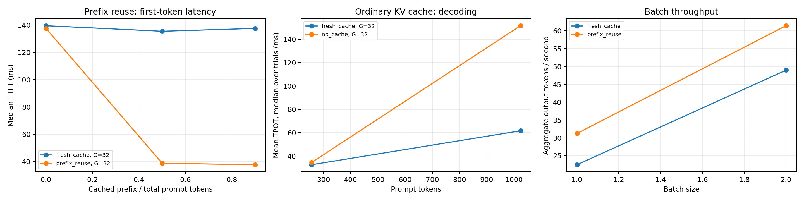

# KV-Cache Inference Benchmarks

**Jayden Cho** · Independent AI inference study

Benchmarks of ordinary KV caching and shared-prefix reuse using **Python, PyTorch,
Hugging Face Transformers, and CUDA** on an **NVIDIA T4**. The repository includes
an executable Colab notebook, its Python cell export, and recorded experiment data.

[](https://colab.research.google.com/github/jaydencho08/kv-cache-inference-benchmarks/blob/main/kv_cache_t4_colab.ipynb)

## Research question

How do context length, batch size, and reusable-prefix length affect inference
latency, token throughput, and GPU memory usage?

The experiment distinguishes two mechanisms:

| Comparison | What changes |
| --- | --- |
| `no_cache` → `fresh_cache` | Keep earlier tokens' keys and values during autoregressive generation instead of recomputing the growing sequence. |
| `fresh_cache` → `prefix_reuse` | Reuse a previously computed exact prompt prefix across requests; both modes still cache during generation. |

## Recorded results

The included quick-profile session contains **42 measured runs**, comprising seven
paired configurations, two modes per configuration, and three repetitions.
All **21 paired comparisons** produced identical generated token sequences, and
no out-of-memory failures were recorded.

| Experiment | Prompt / output tokens | Batch | Reused prefix | Metric | Median paired speedup |
| --- | --- | --- | --- | --- | --- |
| Ordinary KV caching vs. no cache | 1,024 / 32 | 1 | N/A | Total model-execution latency | **2.44×** |
| Prefix reuse vs. fresh cache | 1,024 / 32 | 1 | 512 tokens (50%) | Time to first token | **3.49×** |
| Prefix reuse vs. fresh cache | 1,024 / 32 | 2 | 768 tokens (75%) | Time to first token | **7.00×** |
| Prefix reuse vs. fresh cache | 1,024 / 32 | 2 | 768 tokens (75%) | Total model-execution latency | **1.24×** |

Speedups are medians of paired control/treatment latency ratios, not ratios of
independent medians. A 7× first-token speedup does **not** mean the entire request
finishes 7× faster. The observations apply to the listed configurations.



See the [raw trials](results/20261011-174734/raw.csv),
[paired speedups and bootstrap intervals](results/20261011-174734/paired_speedups.csv),
and [environment record](results/20261011-174734/environment.json).

## Run in Google Colab

1. Click **Open in Colab** above, then choose **File → Save a copy in Drive**.
2. Choose **Runtime → Change runtime type → T4 GPU**, if available.
3. Run the installation cell. It pins Transformers to `4.57.1` and Accelerate to
   `1.11.0` while keeping Colab's CUDA-enabled PyTorch. If Transformers was already
   imported, restart the session and resume at the configuration cell.
4. Keep `PROFILE = "quick"` for the first run. Run the remaining cells in order.
   Confirm the actual GPU name and inspect the correctness checks.
5. Inspect the tables and plots, then run the final cell to download the results ZIP.
6. If the download does not start, open Colab's **Files** sidebar, locate the ZIP
   under `kv_results`, and use its three-dot menu → **Download**.

The notebook loads `Qwen/Qwen2.5-0.5B-Instruct` in FP16 with SDPA attention.
GPU availability and runtime package versions depend on Colab. For a rerun using
the same model weights, set `REVISION` to the commit recorded in `environment.json`.
Change to `PROFILE = "research"` for larger sweeps and more repetitions.

The `.py` file is a **cell-by-cell Colab export**, including notebook display and
download calls; the notebook is the supported entry point.

## Methodology and limits

- Two unmeasured warmups per condition; randomized case/mode order and paired inputs.
- CUDA synchronization at measurement boundaries; fixed output length and greedy decoding.
- Metrics include TTFT, mean time per output token, aggregate tokens/second,
  tensor allocation, actual KV payload, and cache-copy overhead.
- Prefixes must match at the token level. The resident master cache is cloned
  for each reuse request, and its copy cost is included in request latency.
- Prefix construction is measured separately; `amortization.csv` projects how
  repeated hits amortize that setup cost.
- Timings start with GPU-resident input IDs. They exclude model loading,
  tokenization, network transfer, queueing, and CPU text decoding.
- This is a **single-session pilot with three repetitions**, not a production
  serving benchmark. The zero-prefix negative control also showed timing variation.
  Repeat selected conditions across independent sessions before generalizing.
- Controlled token sequences measure execution performance, not answer quality.
  Output agreement is a correctness check, not evidence of task accuracy.
- This implementation does not share physical prefix blocks or implement a
  production scheduler, cache eviction, or concurrent requests.

The [experiment guide](experiment_guide.md) explains the variables, hypotheses,
memory formulas, measurement boundaries, and follow-up experiments in detail.

## Files

```text
kv_cache_t4_colab.ipynb       Executable Colab experiment
kv_cache_benchmark.py        Matching Python cell export
experiment_guide.md          Methods and interpretation guide
requirements.txt            Notebook dependencies; keep Colab's CUDA PyTorch
tests/verify_benchmark.py    Tiny-model CPU correctness and analysis checks
results/20261011-174734/      Recorded T4 data, environment, and plot
```

## Local validation

With a compatible Python environment and PyTorch installed:

```bash
python -m pip install -r requirements.txt
python tests/verify_benchmark.py
```

The validation uses a tiny randomly initialized Qwen2 model on CPU, with no model
download. It checks generation against Hugging Face `generate`, cache size,
master-cache immutability, paired-run summaries, bootstrap calculations,
amortization, and plot export. CPU validation does not measure T4 performance.

## References

- [Hugging Face cache explanation (4.57.1)](https://huggingface.co/docs/transformers/v4.57.1/en/cache_explanation)
- [Hugging Face cache strategies (4.57.1)](https://huggingface.co/docs/transformers/v4.57.1/en/kv_cache)
- [Qwen2.5-0.5B-Instruct](https://huggingface.co/Qwen/Qwen2.5-0.5B-Instruct)
- [PyTorch CUDA semantics](https://docs.pytorch.org/docs/stable/notes/cuda.html)
